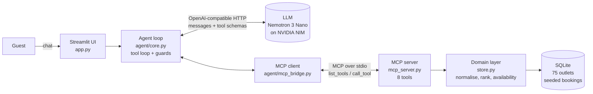

# 🍽️ GoodFoods: AI Reservation Agent

A conversational agent that recommends, checks, books, changes and cancels tables across **75 GoodFoods outlets in Bengaluru**, in English or Hinglish. It runs on a **small open-weight model** (`nvidia/nemotron-3-nano-omni-30b-a3b-reasoning` via the free NVIDIA NIM API, ~3B active parameters), uses a **tool-calling loop written from scratch** (no LangChain or any agent framework), and reaches its tools over the **Model Context Protocol (MCP)**.

| | |
|---|---|
| 🎥 **Demo video** | **[DEMO VIDEO LINK — to be added]** |
| 📄 **Business strategy** | [`docs/USE_CASE.md`](docs/USE_CASE.md) |
| 💬 **Real conversations** | [`docs/TRANSCRIPTS.md`](docs/TRANSCRIPTS.md) (5 journeys, every tool call shown, auto-checked) |
| 🧠 **Model** | `nvidia/nemotron-3-nano-omni-30b-a3b-reasoning` via NVIDIA NIM; any OpenAI-compatible endpoint works (see [Model choice](#model-choice)) |
| 🖥️ **Frontend** | Streamlit chat with a live "agent actions" trace |

---

## Highlights

- **The LLM decides intent.** There is no keyword routing: on every turn the model picks one of 8 MCP tools, or answers directly.
- **MCP tool server** (`goodfoods/mcp_server.py`): the reservation logic is a standalone MCP server. The agent is an MCP client that discovers the tools with `list_tools` and calls them with `call_tool`, so the same server can power WhatsApp, voice, or any MCP client.
- **Correctness doesn't depend on the model.** Capacity is re-checked inside a DB transaction. Writes need an explicit "yes" from the guest, verified in code. Inputs like "kal raat 8 baje", "Koramangla" and "+91 98…" are normalised on the server. Replies that invent a confirmation code or claim availability no tool checked are sent back to the model for a rewrite.
- **Recommendations with reasons.** Ranking uses dish, cuisine, area (with a nearest-area fallback), budget, occasion and amenities, and only includes outlets free at the requested time. Budget is a hard tier: an outlet over the guest's per-person budget never outranks one within it, and within budget the closest to what they want to spend ranks first. Options are numbered, so "the first one" maps to an exact `restaurant_id`. Each suggestion says *why* it fits.
- **A useful "no".** A full slot comes back with nearby free times at the same outlet **and** similar outlets that are free at that time.
- **Tested both ways.** 191 offline tests (no API key needed) plus 5 end-to-end journeys against the real model, checked automatically (the two latest full runs: 5/5 and 5/5; an earlier run was 4/5, so results still vary).

---

## Architecture



In words: **Streamlit UI → agent loop → LLM → MCP client → MCP server → SQLite.** The agent loop sends the conversation and tool schemas to the LLM; when the LLM asks for a tool, the loop validates the call and forwards it through the MCP client to the MCP server, which runs the domain logic against SQLite and returns a structured result.

**One guest turn** (`ReservationAgent.run_turn`):
1. Build the messages: the system prompt (with today's date and a 7-day calendar), the trimmed history, the tool schemas discovered over MCP, the numbered outlets from the latest search (option → `restaurant_id`), and a short reminder of the key rules at the end.
2. Call the LLM. If it asks for tools, validate each call (known tool? valid JSON? write confirmed by the guest? restaurant id seen before?), run it through MCP, append the result, and loop (at most 6 steps).
3. If it answers in text, run the output guards (no leaked reasoning or raw tokens, no invented codes, no unchecked availability claims). If one fails, re-prompt once with a correction. Otherwise return the reply.

---

## Tech choices and why

| Choice | Why |
|---|---|
| **Small open-weight model** (Nemotron 3 Nano: mixture-of-experts, ~3B active parameters per token) | Cheap and fast enough to run every turn, and self-hostable for data residency. See [Model choice](#model-choice). |
| **MCP** (official `mcp` Python SDK, FastMCP server, stdio transport) | A recent, open protocol for exposing tools. The business logic becomes a reusable service rather than code inside the agent. The SDK is a protocol library, not an agent framework. |
| **No agent framework** | The loop is about 300 lines (`agent/core.py`), and the LLM client is plain `httpx` (`agent/llm.py`). Owning the loop lets us handle the failure modes small models really hit (malformed calls, provider `tool_use_failed`, premature confirmations, invented facts). |
| **SQLite + deterministic seed** | Zero setup; `BEGIN IMMEDIATE` transactions prevent double-booking. |
| **Streamlit** | A chat UI in about 100 lines, with an expandable trace of every tool call for demos and debugging. |

---

## Model choice

- **What the brief suggests:** a Llama 3.x 8B-class model (llama-3.3-8b).
- **Why not exactly that:** hosted Llama 8B models are unavailable on the free API tiers (Groq, for example, retired `llama-3.1-8b-instant` during the project).
- **What we use:** `nvidia/nemotron-3-nano-omni-30b-a3b-reasoning` via the **free NVIDIA NIM API** (`https://integrate.api.nvidia.com/v1`). It is a mixture-of-experts model with **~3B active parameters per token**, so it is in the same small-model compute class as an 8B dense model, with open weights and **native tool calling** over the OpenAI-compatible API.
- **Configurable:** the provider and model are pure `.env` settings (`LLM_BASE_URL`, `LLM_MODEL`, `LLM_API_KEY`). Llama 3.1 8B via OpenRouter, or `gpt-oss-20b` via Groq, are one-line changes (see `.env.example`). Nothing in the code is tied to a provider.

### Thinking on vs off

Nemotron 3 Nano is a hybrid-reasoning model: it can "think" before answering. NIM exposes a toggle (`chat_template_kwargs: {"enable_thinking": false}`), available here as `LLM_THINKING=off|on` (empty = model default, which is on).

| Setting | Journeys passed | What went wrong |
|---|---|---|
| Thinking **off** | 3/5 | Skipped procedure: booked without a read-back, cancelled without looking the booking up first |
| Thinking **on** (default) | **5/5** | — (a later full run was 4/5: the 25-guest party was not handed to the events team once; that journey passed 2 of 3 runs) |

Thinking on follows the multi-step booking rules much better, so it stays on. **Reasoning never reaches the guest** either way:
- the client ignores `reasoning_content` entirely;
- any `<think>…</think>` text in the reply is stripped;
- a reply containing `<unk>` tokens, or a tool call written as text (`<tool_call>`, `</function>`), or one cut off by `max_tokens`, is treated as malformed and retried once with a correction. If the retry also fails, the guest gets a short "could you say that again?" instead.

`max_tokens` defaults to 4096 (`LLM_MAX_TOKENS`) so tool-call JSON is never cut off.

---

## Setup

Requires Python 3.10+.

```bash
git clone <repo-url> && cd goodfoods-agent
python3 -m venv .venv && source .venv/bin/activate   # Windows: .venv\Scripts\activate
pip install -r requirements.txt
cp .env.example .env                                 # then set LLM_API_KEY (free NVIDIA NIM key: https://build.nvidia.com)
python -m goodfoods.data.seed --reset                # build the demo DB (also auto-created on first run)
pytest -q                                            # 191 tests, no API key needed
streamlit run app.py                                 # open http://localhost:8501
```

Other entry points:
```bash
python cli.py --trace                 # terminal chat that prints every tool call
python scripts/run_journeys.py        # 5 journeys on the real model -> docs/TRANSCRIPTS.md, PASS/FAIL per check
python -m goodfoods.mcp_server        # the MCP server on its own (e.g. with MCP Inspector)
```

All settings come from `.env` (see `.env.example`): `LLM_API_KEY`, `LLM_BASE_URL`, `LLM_MODEL`, plus optional `LLM_THINKING`, `LLM_MAX_TOKENS`, `LLM_TEMPERATURE`, `GOODFOODS_DB`, `GOODFOODS_TZ` (default `Asia/Kolkata`) and `AGENT_MAX_STEPS`. No secrets live in the code.

---

## Tools (MCP)

Schemas are generated from type-annotated Python functions (`mcp_server.py`) and fetched by the agent at start-up. `?` marks an optional field.

| Tool | Arguments | What it does |
|---|---|---|
| `recommend_restaurants` | `party_size`?, `date`?, `time`?, `cuisine`?, `neighborhood`?, `budget_per_person`?, `occasion`?, `features`?: array, `pure_veg`?, `dish`?, `limit`? | Ranked, numbered (`option`) suggestions with a `why`. With date, time and party size, only outlets that are free. Echoes the resolved `query` (e.g. `kal` → `2026-10-28`). |
| `search_restaurants` | `cuisine`?, `neighborhood`?, `max_cost_for_two`?, `min_rating`?, `features`?: array, `pure_veg`?, `query`?, `limit`? | Plain filtering, e.g. to find a named outlet |
| `get_restaurant_details` | `restaurant_id` | Address, hours, phone, signature dishes. Explicitly returns `"availability": "not checked…"` |
| `check_availability` | `restaurant_id`, `date`, `time`, `party_size` | Free/full; if full, nearby free times and same-cuisine outlets free at that time |
| `create_reservation` | `restaurant_id`, `date`, `time`, `party_size`, `guest_name`, `phone`, `user_confirmed`, `special_requests`? | Books inside a transaction that re-checks capacity and duplicates |
| `get_reservation` | `confirmation_code`, `phone` | Lookup (both must match; same error for a wrong code or a wrong phone) |
| `modify_reservation` | `confirmation_code`, `phone`, `user_confirmed`, `new_date`?, `new_time`?, `new_party_size`?, `special_requests`? | Change at the same outlet; the original booking is kept if the new slot is full |
| `cancel_reservation` | `confirmation_code`, `phone`, `user_confirmed` | Cancel |

`restaurant_id` accepts an id from a tool result or the outlet's name. Every tool returns `{"ok": true, ...}` or a structured, recoverable error `{"ok": false, "error_code", "message", "hint"}`. Examples: `CONFIRMATION_REQUIRED`, `NOT_AVAILABLE` (with alternatives), `BAD_PHONE`, `BAD_PARTY_SIZE`, `PARTY_TOO_LARGE`, `DATE_IN_PAST`, `TIME_IN_PAST`, `UNKNOWN_NEIGHBORHOOD`. The `hint` tells the model what to do next.

### Data
`goodfoods/data/seed.py` generates the data deterministically: **75 outlets** across 12 neighbourhoods and 18 cuisines, with capacities from 24 to 120 seats, ratings, cost for two, pure-veg flags, amenities, opening hours and signature dishes. It also creates about 15k existing reservations over the next two weeks, so popular weekend dinners are genuinely full and the "full → alternatives" path is real.

### Relative dates

Small models get date arithmetic wrong (live run: "next Friday" → Saturday 31 Oct), so relative dates are resolved in code (`goodfoods/dates.py`, `Asia/Kolkata`) and the model passes the guest's words:

| Phrase (English / Hinglish) | Resolves to | On Tue 27 Oct 2026 |
|---|---|---|
| today, tonight / aaj | today | Tue 27 Oct |
| tomorrow / kal | today + 1 | Wed 28 Oct |
| day after tomorrow / parso | today + 2 | Thu 29 Oct |
| friday, this/coming friday / shukravar, is shukravar | the next Friday, **today included** | Fri 30 Oct |
| next friday, friday next week / agle shukravar | the Friday of **next calendar week** (weeks run Mon–Sun) | Fri 6 Nov |
| weekend, this weekend / is weekend | this week's Saturday (today if already Sat/Sun) | Sat 31 Oct |
| next weekend / agle weekend | Saturday of next calendar week | Sat 7 Nov |

**Why this "next" rule:** it is one rule with no "if today is…" exceptions, and it matches how most people use "next Friday" early in the week (the one after this coming one). On Fri–Sun the "this" and "next" forms can land on the same day, which is still unambiguous. Every tool result echoes `date`, `weekday` and `date_interpreted` (e.g. `'next friday' = Friday, 06 Nov 2026`), and the reply quotes them, so the guest can correct a misunderstanding before anything is booked. "Next week" alone is not resolved; the model asks which day.

---

## Prompt engineering approach

The prompts live in [`goodfoods/agent/prompts.py`](goodfoods/agent/prompts.py). The system prompt is structured for a small model:

1. **Scope first.** The first block says what Goodie does (GoodFoods outlets, tables and bookings, in English or Hinglish) and that anything unrelated to dining (poems, code, trivia) gets a one-line decline plus an offer to find a table. It is deliberately not a canned sentence: the model copied an exact example line onto in-scope Hinglish replies, so the rule describes the behaviour instead.
2. **Date grounding, resolved in code.** Every turn injects today's date, weekday, current time and a 7-day calendar, but the model is told *not* to do date arithmetic: it passes the guest's own words ("next friday", "kal", "this weekend") and the server resolves them (see [Relative dates](#relative-dates)). Tool results return `date`, `weekday` and `date_interpreted`, and the model must quote those. Times: "raat/shaam 8" = 20:00, all in `Asia/Kolkata`.
3. **Short numbered rules (14).** Small models follow lists more reliably than prose. The key rules:
   - **Facts only from tools.** Never invent outlets, ids, prices, codes or availability.
   - **Numbered options, exact ids.** List outlets numbered in the order the tool returned them; when the guest says "the first one" or "pehla wala", reuse that option's exact `restaurant_id`. The agent restates the latest numbered list (option → id) before every call so this survives long turns.
   - **No unchecked availability.** Never say a table is free or full unless `check_availability` (or `create_reservation`, or a recommendation that carries an `availability` field) returned it. `get_restaurant_details` is called out by name because the model treated it as a check.
   - **Booking order:** outlet, date, time, party → `check_availability` → *only then* ask for name and mobile → read back → yes → `create_reservation`.
   - **Large groups go straight to the events team.** Over 20 guests: reply at once with the events contact, no follow-up questions (also enforced in code, below).
   - **Pass only what the guest said.** Never add filters (features, cuisine, pure-veg, budget) the guest didn't ask for; an occasion goes in `occasion`, not `features`. A named dish goes in `dish`, not `cuisine`. Always pass date, time and party size when given.
   - **Confirm before commit.** Read back the details, ask "Shall I confirm?", and set `user_confirmed=true` only after the guest says yes.
   - **Recover from errors.** Read the `message` and `hint` of any `ok=false` result, fix the input or ask the guest, and never repeat a failing call.
   - **Be honest about what we lack.** Say plainly when we don't have something; use `area_note` / `budget_note` from results.
4. **Recency reminder.** Small models weigh the last instruction most, so a three-line reminder (scope, no unchecked availability, reply language in Latin-script Hinglish) is appended as the final system message on every call.
5. **Tool descriptions are part of the prompt.** Each is one or two imperative sentences with the valid values inline (cuisines, areas, amenities), e.g. *"If they name a dish, pass dish and NOT cuisine"* and *"Does NOT check tables"*. Optional fields are flattened from `anyOf[X, null]` to `X`, because small models handle flat schemas far better.
6. **Tool results steer the next step.** Results carry plain-language notes: `availability_note` says which fields are missing ("missing date: if the guest said 'kal', call again with it"), `area_note` names the closest outlet when the requested area has none, `dish_note` explains an ignored cuisine guess, and `budget_note` says all options are within budget.
7. **Low temperature (0.2)**, reasoning kept on but hidden (see [Thinking on vs off](#thinking-on-vs-off)), and a generous `max_tokens` so tool calls are never truncated.

### Guardrails enforced in code (not just prompted)

| Guard | Where | What it stops |
|---|---|---|
| **Confirm-before-commit** | `core.py` `_execute` (host) + every write tool (server) | The server refuses any write without `user_confirmed=true`. The model sets that flag, so the **host also checks the guest's actual words**: the latest message must be an explicit yes (English or Hindi: "yes", "go ahead", "haan kar do"…, with no "no / wait / change"), and the previous assistant message must have asked a question (the read-back). The model cannot get past this check, because it runs on the real guest message, not on anything the model writes. In live runs the model sent `user_confirmed=true` early and got `CONFIRMATION_REQUIRED`. |
| Unchecked availability claim | `core.py` `claims_availability` | A reply that says "table is available/full" before any availability tool ran is sent back once with a correction |
| Invented confirmation code | `core.py` `_invented_code` | A `GF-XXXXXX` code that no tool returned triggers a rewrite |
| Guessed restaurant id | `core.py` `_execute` | An id that never appeared in a tool result or the guest's message is refused (`UNVERIFIED_RESTAURANT_ID`) |
| Malformed calls | `core.py`, `llm.py` | Bad JSON, unknown tools, empty-string args, `"true"` as a string; provider `tool_use_failed` is repaired once |
| Leaked reasoning / broken output | `llm.py` `sanitize_content`, `is_malformed` | `reasoning_content` is never shown; `<think>` blocks are stripped; `<unk>` tokens, tool calls typed as text, or truncated replies trigger one retry |
| Runaway loops / context | `core.py` | A 6-step cap per turn; history trimming that never starts on an orphaned tool result |
| Provider errors | `llm.py` | 429/5xx backoff that honours Retry-After; quota exhaustion fails fast with a clear message; timeouts; bad key |
| Relative dates | `dates.py`, `core.py` `reconcile_dates` | The server resolves "next friday", "kal", "agle shanivar", "this weekend". If the guest's latest message has such a phrase but the model sent a different calendar date (its own arithmetic), the host swaps in the guest's phrase so the server resolves it. Skipped when the guest also named an explicit date ("2 Nov") |
| Large groups (>20) | `store.py` `normalize_party`, `core.py` `needs_events_contact` | Every tool that takes a party size checks it **first** and returns `PARTY_TOO_LARGE` with `events_contact`. If the guest said more than 20 people (or a tool said `PARTY_TOO_LARGE`) and the reply lacks the contact, the model is re-prompted once; if it still leaves it out, the contact is appended to the reply |
| Input validation | `store.py` | 10-digit Indian mobiles (6–9 start, `+91`/`0` stripped), party size 1–20 (over 10 needs private dining, over 20 goes to the events team), no past dates or times, a 60-day window, opening hours, capacity |

> **Why the confirmation guard is host-side:** in MCP the server sees only the arguments the model sends, never the guest's words, so a server-only check would trust the model. The host (agent loop) is the only component that sees both the guest's real message and the model's tool call, so the deterministic check lives there, and the server's flag is a second layer for any other MCP client.

---

## Example conversations

Full transcripts from real runs, with every tool call and the automatic check results, are in **[`docs/TRANSCRIPTS.md`](docs/TRANSCRIPTS.md)** (`python scripts/run_journeys.py`). A journey only passes if the right tools ran in the right turn, with the right resolved arguments, and the reply says what the tool returned.

| # | Journey | What it shows |
|---|---|---|
| 1 | **Recommendation → availability → booking**: anniversary, Saturday 8 pm, ~₹1500/person, 2 people | Within-budget options first, closest to budget on top; "the first one" checks and books exactly the first recommended `restaurant_id`; `check_availability` before asking for name/phone; read-back; booking only after "yes"; the real code quoted |
| 2 | **Fully booked → alternatives**: 6 people at a full outlet | `available=false`; offers nearby times and same-cuisine outlets |
| 3 | **Hinglish**: "Kal raat 8 baje 2 logon ke liye Indiranagar mein biryani wali jagah suggest karo" | Resolves to tomorrow 20:00 for 2; biryani → our Mughlai outlets; none in Indiranagar, so it names the closest (MG Road, ~4 km); replies in Hinglish |
| 4 | **Look up & cancel** with code + phone | `get_reservation` → read-back → "yes" → `cancel_reservation` |
| 5 | **Edge cases**: 25 people, a poem request, booking for yesterday | Events-team hand-off; one-line decline that redirects to bookings; past date rejected |

Abridged, journey 3:
```
Guest:  Kal raat 8 baje 2 logon ke liye Indiranagar mein biryani wali jagah suggest karo
  → recommend_restaurants(dish="biryani", neighborhood="Indiranagar", party_size=2, date="2026-10-28", time="20:00")
    ← Mughlai outlets free at 20:00, nearest_area_fallback=true, "Closest: Biryani Darbar - MG Road (~3.8 km)"
Goodie: Indiranagar mein biryani outlet nahi hai, sabse paas GoodFoods Biryani Darbar – MG Road hai (~₹730/person)…
```

---

## What live testing caught (iteration log)

Running the journeys against real models surfaced failures that the unit tests missed. Each one was fixed in code or tool design, and the fix is covered by a test:

| # | What the model did | Risk | Fix |
|---|---|---|---|
| 1 | Said "I have confirmed a table for two is available" after only calling `get_restaurant_details` | Promising a table that may be full | Rule + booking order in the prompt; `get_restaurant_details` returns `"availability": "not checked"`; the output guard re-prompts unchecked availability claims; the journey check fails on any unbacked claim |
| 2 | Wrote a full poem about cats | Off-brand, wasted tokens, looks unreliable | Scope block at the top of the prompt + recency reminder; the journey checks the reply is short, has no poem and redirects to bookings |
| 3 | Hinglish biryani request: added `cuisine="North Indian"` itself, dropped "kal", and named no outlet (the old check still printed PASS) | Wrong or empty results | Data-driven dish → cuisine mapping (from menus) that ignores a conflicting guessed cuisine; nearest-area fallback by distance; the tool echoes the resolved `query` and says which slot fields are missing; Hinglish date and time parsing on the server; the check now asserts date = tomorrow, time = 20:00 and that a returned outlet is named |
| 4 | Asked for ~₹1500/person but got ₹450–870 options | Feels like the bot ignored the budget | Ranking by closeness to budget (±15% counts as close); `budget_note` when everything is under budget |
| 5 | Copied the example decline line onto an in-scope Hinglish answer | Refusing real customers | The scope rule describes behaviour rather than giving a sentence to copy; the reminder says food requests in any language are in scope |
| 6 | Mixed Devanagari into a Hinglish reply | Inconsistent script for Hinglish users | Rule: Hinglish in Latin letters; checked in the journey |
| 7 | Sent `user_confirmed=true` before the guest said yes | Unconfirmed booking | Host-side check on the guest's actual words + server flag (fired in live runs) |
| 8 | Guessed `restaurant_id=GF012` for a different outlet | Booking the wrong restaurant | `UNVERIFIED_RESTAURANT_ID` guard; tools accept outlet names |
| 9 | Printed codes with a Unicode hyphen (`GF‑1ANHOH`) | Code can't be pasted back to cancel | Replies are normalised to an ASCII hyphen |
| 10 | Provider churn: Groq retired Llama 3.1 8B mid-project | Demo breaks | The provider and model are pure config; clear 404 and auth errors |
| 11 | Passed the outlet name with an en dash (`Cantina – MG Road`) and got `AMBIGUOUS_RESTAURANT` | Booking stalls | Name resolution normalises dashes and spacing, and prefers an exact name match |
| 12 | (Infrastructure, caught by the stricter journeys) the MCP SDK starts the server with a minimal environment, so `GOODFOODS_DB` was silently dropped and the server used a different database | Bookings "not found" | The bridge forwards `GOODFOODS_*` settings and sets the server's working directory |
| 13 | Guest said "the first one" but the model checked and booked a different outlet: it had shown the list in a different order from the tool result | Booking the wrong restaurant | Results carry an `option` number; the prompt says list in returned order and reuse the exact id; the agent restates option → `restaurant_id` every call; the journey asserts the checked and booked id equal the first recommendation |
| 14 | Nemotron printed its chain-of-thought into the reply, then `<unk>` tokens and a tool call as text | Gibberish shown to the guest; no tool ran | `reasoning_content` ignored, `<think>` stripped, malformed output retried once; `max_tokens` raised to 4096; thinking toggle compared (on: 5/5, off: 3/5) |
| 15 | An outlet ~13% over the ₹1500 budget ranked first because the occasion bonus outweighed the budget penalty | Upselling past what the guest said | Budget is a hard sort tier (over budget never outranks within budget); within budget, closeness to budget weighs more; tested on queries where bonuses would otherwise win |
| 16 | "Next Friday" became 2026-10-31, a Saturday: the model did its own date arithmetic | Booking the wrong day | Server-side resolver for relative phrases (English + Hinglish) with a documented "next" rule; tools echo `date_interpreted`; the host overrides a model-computed date that disagrees with the guest's phrase; 60+ resolver tests |
| 17 | For 25 guests the model asked "which outlet / what time?" instead of handing off | Wasted turns, then a refusal anyway | `PARTY_TOO_LARGE` checked first in every tool with `events_contact`; prompt rule; host guard re-prompts, then appends the contact |
| 18 | Added `features: ["private_dining", "outdoor_seating"]` the guest never asked for | Narrows results for no reason | Explicit rule (an occasion is not a feature); journey 1 now fails on unrequested filters |

---

## Testing

```bash
pytest -q                              # 191 tests, ~2 s, no API key
python scripts/run_journeys.py         # real model, writes docs/TRANSCRIPTS.md
python scripts/run_journeys.py hinglish  # one journey
```

- `tests/test_store.py`: outlet names with typographic dashes, normalisation (dates including "kal"/"parso", times including "raat 8 baje"/"saade 8", phones, party size), past date/time rejection, dish → cuisine mapping, nearest-area fallback, budget ranking (over-budget never outranks within-budget; closest to budget first), capacity and alternatives, the booking lifecycle, and the server-side confirmation gate.
- `tests/test_agent.py`: a scripted fake LLM drives the **real agent against the real MCP server**: tool discovery, the full booking flow, the confirmation guard (8 phrasings, plus "yes before any read-back" and "flag false"), the availability-claim rewrite, malformed calls, unknown tools, provider repair, config forwarding to the MCP server, invented codes, rate limits, the loop cap and history trimming.
- `tests/test_dates.py`: every relative phrase (today/tonight/kal/parso, this/next/coming weekday, weekend, Hindi weekday names, "agle"/"is") from a Tuesday and from Fri/Sat/Sun; the host-side date override and when it must *not* fire; `date_interpreted` in results; `PARTY_TOO_LARGE` from all four party-size tools even with other bad inputs; party-size parsing ("25 people", "hum 30 log", not "25 nov"); the events-contact guard.
- `tests/test_llm.py`: the output sanitizer (`<think>` stripping, `<unk>` / text tool-call detection, truncation), `reasoning_content` never surfacing, the thinking toggle and `max_tokens` in the request, the one-shot malformed-output retry, and the numbered option → `restaurant_id` note (even on truncated results).
- `scripts/run_journeys.py`: the 5 journeys above on the real model, run on a freshly seeded DB (`data/journeys.db`), with per-turn checks on tool calls, resolved arguments and reply content.

---

## Business strategy (summary)

The full document is [`docs/USE_CASE.md`](docs/USE_CASE.md): success criteria, bot flow, a state diagram, an ROI model, stakeholders, timeline, vertical expansion and risks.

- **Problem:** per-outlet phone bookings miss calls at the 7–9 pm peak, pull hosts off the floor, and lose the guest whenever one outlet is full.
- **Non-obvious value:** chain-wide **demand routing** (a full outlet becomes a sister-outlet booking), an **unmet-demand heatmap** for capacity and expansion decisions, off-peak demand shaping, and no-show reduction.
- **Reach:** Hinglish today, regional languages and voice next. This serves guests who will never install an app.
- **North-star metric:** peak seat utilisation. The modelled upside is **≈ ₹8–9 Cr/year** across 75 outlets (labelled assumptions, to be validated in a 10-vs-10-outlet pilot), against an LLM cost under ₹1 per conversation.
- **Expansion:** multi-tenant SaaS for F&B chains, then hotels and banquets, salons, clinics, coworking and turfs. Same agent, different MCP tool servers.
- **Edge:** channel-agnostic MCP tools (web → WhatsApp → Indic voice), small-model economics with deterministic safety, and chain-wide intelligence that turns a cost tool into a revenue tool.

---

## Project structure

```
app.py                     Streamlit UI (chat + agent-action trace)
cli.py                     terminal chat
goodfoods/
  config.py                env-driven settings and business rules
  store.py                 domain logic: normalisation, ranking, availability, bookings
  mcp_server.py            MCP server exposing 8 tools
  data/seed.py             deterministic data generator (75 outlets, ~15k bookings)
  agent/
    llm.py                 OpenAI-compatible HTTP client (retries, error taxonomy, output sanitizer)
    mcp_bridge.py          MCP client: long-lived session, MCP schema → function schema
    prompts.py             system prompt, reminder, repair/grounding prompts
    core.py                the agent loop and guards
scripts/run_journeys.py    real-model journeys with strict checks → docs/TRANSCRIPTS.md
tests/                     191 offline tests (store, dates, LLM client, agent loop over real MCP)
docs/                      USE_CASE.md (business strategy), TRANSCRIPTS.md (real runs)
```

---

## Assumptions

- A single city (Bengaluru), the `Asia/Kolkata` timezone, and a 90-minute table hold. Capacity is modelled as seats per outlet, not individual tables.
- Bookings sit on a 30-minute grid, last seating is 1 hour before close, and bookings open up to 60 days ahead.
- Online bookings take 1–20 guests. Parties over 10 need an outlet with private dining; over 20 go to the events team.
- A bare time like "8" means 8 pm (restaurant context), and "kal" means tomorrow (booking context).
- "Next <weekday>" means that day in the next Monday–Sunday week (see [Relative dates](#relative-dates)).
- Guest identity is confirmation code + mobile. There is no OTP in this prototype.
- Business figures in the strategy doc are planning assumptions, clearly labelled.

## Limitations

- Built and tested on free-tier APIs: rate limits slow multi-turn runs (NIM occasionally returns 503 "worker limit reached", which is retried), and model availability changes (Groq retired Llama 3.1 8B during the project).
- Not run on the exact model the brief names (Llama 3.x 8B); see [Model choice](#model-choice). Journey results on Nemotron 3 Nano vary between runs (latest two full runs 5/5 each, an earlier one 4/5), and thinking adds latency.
- A small model sometimes picks a sub-optimal tool or asks one extra question. The guards keep it safe, not perfect, and journey results vary between runs.
- The out-of-scope decline is enforced by the prompt, not by code. It is checked in the journeys but can't be guaranteed.
- SQLite with a single process suits a demo. Production would use Postgres and a hosted MCP server (Streamable HTTP).
- Seat-level capacity can't model table shapes (a 2-top can't seat 4). No SMS/WhatsApp, OTP or payments yet.

## Future work

- **WhatsApp channel:** the same MCP tools behind a WhatsApp Business bot, with booking confirmations sent as messages.
- **Voice:** an Indic STT/TTS voice agent on the outlet phone numbers (where most bookings happen today).
- **Regional languages:** Kannada, Tamil, Telugu and Hindi (Devanagari) input and output, using Indic models.
- **Reminders:** reminders, one-tap modify/cancel links, and a waitlist that auto-offers freed tables.
- **POS / reservation-system integration:** swap SQLite for the chain's real inventory behind the same MCP tools; table-level assignment.
- **Analytics and evals:** persist tool events for funnel and unmet-demand dashboards; a larger scored eval set run on every prompt or model change.

---

*Development note: I used an AI coding assistant to help scaffold parts of this project. I reviewed, ran and tested all of it, and I can walk through every design decision.*


this is the repo 