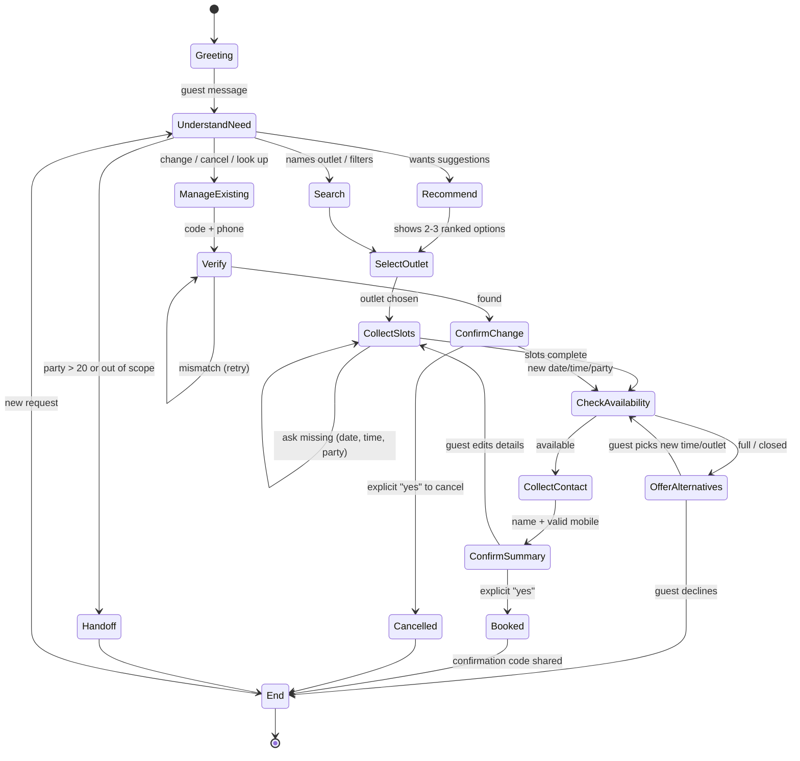

# GoodFoods AI Reservation Agent: Use Case & Business Strategy

> Follows the Sarvam use-case template (Success Criteria → Use case → Key Steps → State Transition Diagram), then covers the business case the challenge asks for.
> **All figures marked *(assumption)* are planning estimates to validate in the pilot. They are not GoodFoods data.**

---

## Success Criteria

The bot succeeds if guests can find and secure a table faster than by phone, and GoodFoods fills more seats with less staff effort.

| Area | Metric | Target (pilot, 8 weeks) |
|---|---|---|
| Guest outcome | **Booking completion rate**: conversations with booking intent that end in a confirmed reservation | ≥ 65% |
| Guest outcome | Median time to a confirmed booking | < 90 seconds |
| Guest outcome | Self-serve containment: resolved without a human | ≥ 80% |
| Quality | **Zero invalid bookings**: no overbooking, no booking outside hours, no unconfirmed writes | 100% (enforced in code) |
| Quality | Hallucinated facts (codes, availability) in audited transcripts | 0 in weekly 100-conversation audit |
| Business | Peak-hour enquiries answered (vs missed calls today) | 100% (24×7, unlimited concurrency) |
| Business | No-show rate on bot bookings vs phone bookings | −30% relative |
| Business | Share of "fully booked" enquiries redirected to a sister outlet or another time | ≥ 40% |
| Ops | Front-desk minutes on booking calls per outlet per day | −60% |
| Cost | LLM cost per conversation | < ₹1 *(small-model API pricing; verify)* |

---

## Use case (100 words)

GoodFoods runs 75 outlets across Bengaluru. Today reservations happen over phone calls to each outlet, so peak-hour calls go unanswered, staff are pulled off the floor, and a guest who hears "we're full" usually ends up at a competitor. **Goodie** is a conversational reservation agent that recommends the right outlet (cuisine, area, budget, occasion, group size), checks live table availability, and books, changes or cancels reservations in English, Hindi or Hinglish. Because it sees availability across the whole chain, a full outlet becomes a redirect to a sister outlet or a nearby time rather than a lost guest.

---

## Key Steps (bot flow, guest-facing)

1. **Tell us what you want.** For example: "Dinner for 4 tomorrow at 8, North Indian, Koramangala", or just "somewhere nice for an anniversary".
2. **Get 2–3 tailored suggestions.** Each one shows area, cuisine, cost per person, and *why* it fits (budget, occasion, amenities, dish). Once date, time and party size are known, only outlets with a free table at that time are suggested. If nothing matches in your area, the closest outlet elsewhere is offered and the bot says so.
3. **Pick one, or ask more.** Ask for address, hours or signature dishes. If your first choice is full, you get the nearest free times and similar outlets that are free.
4. **Share name and mobile.** Asked only after the table is confirmed free, and only for what's missing.
5. **Confirm.** The bot reads back outlet, date, time, guests, name and phone, and books only after you say yes.
6. **Get a confirmation code.** Code + address, ready to share. *(Production: SMS/WhatsApp copy plus a reminder.)*
7. **Change or cancel anytime.** Use your code and phone number. Changes are checked against live availability, and the old booking stays intact if the new slot is full.
8. **Out-of-scope or large groups.** Parties above 20 are handed to the events team with contact details. Non-dining requests are politely declined.

---

## State Transition Diagram

---

## 1. Business problems & opportunities

### The obvious problem (what the brief asks for)
| Pain today | Impact |
|---|---|
| Bookings run through per-outlet phone lines | Calls are missed at 7–9 pm, exactly when demand peaks |
| Hosts juggle the floor and the phone | Slower table turns, worse in-person service |
| No single view of availability across 75 outlets | "We're full" sends the guest to a competitor, even when the outlet 2 km away has space |
| Bookings in notebooks or basic software | No guest history, no reliable no-show data |

### Non-obvious opportunities (where the real value is)
1. **Chain-level demand routing.** A full outlet is a sales lead for a sister outlet. The agent already returns *same-cuisine outlets free at that time* and *nearby free times*. Every redirect is revenue the chain keeps.
2. **Unmet-demand intelligence.** Every conversation can log what guests wanted and didn't get ("Japanese, Indiranagar, Saturday 8 pm, 6 people, full"). Aggregated, this is a weekly **demand heatmap**: where to add capacity, which outlet to expand, which cuisine to open next. Phone calls never captured this.
3. **Off-peak demand shaping.** Knowing peak saturation in advance lets the agent nudge flexible guests ("7:00 pm is free and has a 10% early-bird offer"). This flattens the 8 pm spike and raises seat utilisation without discounting peak tables.
4. **No-show reduction.** Structured bookings with verified mobiles enable automated reminders and one-tap cancel/modify links. Freed tables go back to inventory, and waitlist guests can be offered them.
5. **Guest memory & personalisation.** Occasions, allergies and seating preferences are captured as structured `special_requests` today, and as a guest profile later. This enables birthday outreach, an "usual table", and allergy flags to the kitchen.
6. **High-value lead capture.** Parties over 20 are already routed to the events team (the prototype shares their contact). In the pilot this becomes a qualified hand-off, with date, headcount and budget already collected.
7. **Pre-orders & deposits.** For large or peak bookings, collect pre-orders or a small deposit. That improves kitchen prep and cuts no-shows (phase 3).

---

## 2. Success metrics & ROI

### North-star metric
**Seats filled per available seat-hour at peak (utilisation)**. Every capability (answering 100% of enquiries, redirecting when full, cutting no-shows, shaping demand) moves this one number.

### ROI model *(all inputs are assumptions to replace with pilot data)*

| Input | Value |
|---|---|
| Outlets | 75 |
| Booking enquiries per outlet per day | 20 → **1,500/day chain-wide** |
| Share of peak enquiries missed today (unanswered/abandoned) | 15% |
| Of those, guests truly lost to competitors (net-new for us if answered) | 30% |
| Average party size | 3.2 |
| Average spend per cover | ₹700 |
| Baseline no-show rate → with reminders | 12% → 8% |
| Share of no-show tables re-sold when freed early | 50% |
| Booking-call handling time | 3 min |

| Value lever | Calculation | Annual value |
|---|---|---|
| Recovered missed enquiries | 1,500 × 15% × 30% ≈ 68 bookings/day × 3.2 × ₹700 | **≈ ₹5.5 Cr** |
| Redirects when an outlet is full | conservatively 20 bookings/day retained × 3.2 × ₹700 | **≈ ₹1.6 Cr** |
| No-show reduction | ~900 bookings/day × 4 pts × 50% re-sold × 3.2 × ₹700 | **≈ ₹1.5 Cr** |
| Staff time released | 1,500 × 3 min × 70% automated ≈ 52 hrs/day (~6–7 FTE) | ≈ ₹20 L (redeployed to the floor) |
| **Total gross upside** | | **≈ ₹8–9 Cr / year** |

**Cost side:** small-model inference (the prototype's open-weight model makes ~5 LLM calls per conversation) costs well under ₹1 per conversation at current hosted prices *(verify at deployment)*. That is roughly ₹5–15 L/year at this volume, plus messaging (SMS/WhatsApp) and one small engineering team. **Payback: within the pilot quarter, even if the upside is 5× smaller than modelled.**

### Measurement plan
- **A/B by outlet:** 10 pilot outlets with the agent vs 10 matched control outlets (cuisine, area, rating) for 8 weeks.
- **Instrumentation:** the agent already records every tool call as a structured event (arguments, result, error code, latency) and shows it in the UI trace. Persisting these events (a pilot task) gives funnel conversion (intent → recommend → availability → confirm → booked), failure reasons, and unmet-demand data almost for free.
- **Weekly transcript audit** of 100 random conversations for hallucination, tone and policy compliance.

---

## 3. Stakeholders & customers

| Stakeholder | What they care about | What they get |
|---|---|---|
| **Guests** | Fast, certain booking, any time, in their language | 24×7 booking in under 90 s, instant alternatives, easy changes |
| **Outlet managers / hosts** | Fewer calls, accurate covers forecast | Phone load drops; daily booking sheet; fewer no-shows |
| **GoodFoods leadership (COO/CMO)** | Revenue, utilisation, brand | Recovered revenue, demand heatmap, guest data asset |
| **Events / catering team** | Qualified large-group leads | Structured hand-offs with headcount, date and budget |
| **IT / Data** | Security, integration, DPDP compliance | MCP tool server over their existing DB/POS; PII minimised (phone stored, only last 4 shown) |
| **Kitchen** | Prep accuracy | Covers forecast; allergy/occasion notes; pre-orders later |

**Potential customers beyond GoodFoods:** multi-outlet casual-dining and QSR chains, cloud-kitchen brands adding dine-in, hotel F&B groups, mall food courts and fine-dining groups with event spaces.

---

## 4. Implementation timeline

| Phase | Weeks | Scope | Exit criteria |
|---|---|---|---|
| **0. Discovery** | 1–2 | Map booking policies per outlet (hours, turn times, table mix, deposits), integrate the reservation DB/POS, define escalation paths | Signed-off policy config; data access |
| **1. Pilot (web + WhatsApp)** | 3–10 | This agent on 10 outlets; reminders; human hand-off; dashboards | Completion ≥ 65%, zero invalid bookings, CSAT ≥ 4.3/5 |
| **2. Voice + scale** | 11–18 | Same MCP tools behind a **voice agent** (Indic STT/TTS) on outlet phone numbers; all 75 outlets; table-level inventory | ≥ 80% containment on calls; missed calls → 0 |
| **3. Revenue features** | 19–30 | Waitlist, off-peak offers, deposits/pre-orders, guest profiles, demand-heatmap reports | Measured lift in peak utilisation and repeat visits |

---

## 5. Vertical expansion

The architecture splits **conversation (LLM agent)** from **business capability (MCP tool server)**. Expanding to a new vertical means swapping or adding tool servers and policies, not rebuilding the agent.

| Expansion | What changes | What is reused |
|---|---|---|
| **Other restaurant chains** (horizontal SaaS) | Tenant config: outlets, hours, turn times, policies; brand persona | Agent loop, guardrails, recommendation engine, UI, analytics |
| **Hotels / banquets** | Inventory = rooms/halls; multi-day bookings; quotes | Search → recommend → check → confirm → book flow |
| **Salons, spas, fitness studios** | Inventory = staff × service duration | Slot engine (duration-based overlap already implemented) |
| **Clinics & diagnostics** | Doctors' slots; stricter identity checks; reminders | Two-phase confirmation, code + phone verification, reminders |
| **Coworking / meeting rooms, sports turfs** | Room/court inventory, hourly pricing | Capacity + availability engine |
| **Events & experiences** | Ticketed capacity, group bookings | Large-party hand-off, capacity checks |

Product path: **GoodFoods pilot → "Reservations Agent" SaaS for F&B chains → "Booking Agent platform"** for any capacity-constrained, appointment-driven business. India-first moat: **multilingual voice + WhatsApp** reach the guests who will never install an app.

---

## 6. Competitive advantages of this approach

1. **Tool-first, channel-agnostic (MCP).** Business logic lives in an MCP server that any agent or channel can call: this web app, a WhatsApp bot, a phone voice agent, even third-party assistants. Competitors' booking widgets are UI-bound; this is an *API for conversations*. Adding voice is a front-end change, not a rebuild.
2. **Small-model economics with deterministic safety.** The agent runs on a small open-weight model (NVIDIA Nemotron 3 Nano, a mixture-of-experts model with ~3B active parameters; Llama 3.1 8B or gpt-oss-20b work by changing config), which is cheap, fast and self-hostable for data residency (DPDP). It stays reliable because correctness doesn't depend on the model: capacity checks run inside DB transactions; a write needs both the tool's `user_confirmed` flag and a code check that the guest's own latest message is a "yes" to a read-back; inputs are normalised server-side ("8 pm", "kal raat 8 baje", typos); and replies that invent confirmation codes or claim unchecked availability are sent back for a rewrite. The LLM handles language; code handles truth.
3. **Chain-wide intelligence, not single-outlet booking.** Because one agent sees all 75 outlets, every "no" becomes a redirect, and every conversation becomes demand data. That turns a cost-saving tool into a **revenue and planning tool**, which is a different (and larger) budget line for the client.

---

## 7. Risks & mitigations

| Risk | Mitigation |
|---|---|
| LLM books the wrong thing | Read-back before every write + server-side `user_confirmed` gate + agent-side check that the guest's latest message is an explicit yes to a read-back question |
| Overbooking under concurrency | `BEGIN IMMEDIATE` transactions re-check capacity at write time; duplicate-booking detection |
| Hallucinated availability/codes | Facts only from tool results; output guards rewrite replies that contain unknown codes or claim availability no tool checked |
| PII / privacy | Code + phone required to view or change a booking; identical errors for wrong code vs wrong phone (no enumeration); only last 4 digits echoed |
| Model/provider outage | OpenAI-compatible client means one env var to switch providers; friendly degradation message; human hand-off (pilot) |
| Guests prefer calling | Phase 2 voice agent on the same tools |

